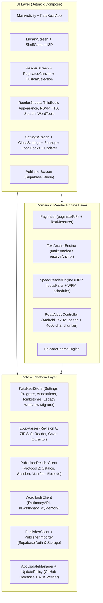

# Laporan Audit, Inventarisasi Fitur, Analisis Risiko & Roadmap Migrasi KataKecil ke Kotlin Native + Jetpack Compose

> [!IMPORTANT]
> Dokumen ini merangkum hasil audit menyeluruh atas 100% kode sumber repositori **KataKecil (`v1.2.3`, `versionCode 11`, `id.karisyono.katakecil`)** sebelum migrasi dari arsitektur Hybrid Web/Capacitor (HTML/CSS/JS/TS + WebView) ke **100% Native Android (Kotlin + Jetpack Compose)** tanpa ketergantungan pada Capacitor maupun WebView.

---

## 1. Hasil Audit Kode Sumber & Arsitektur Saat Ini

### 1.1 Struktur Proyek & Build Pipeline Saat Ini
Repositori KataKecil saat ini menggunakan arsitektur hybrid berbasis **Capacitor 8** yang membungkus aplikasi web statis (`dist/`) ke dalam `BridgeActivity` Android WebView:

| Area | Path Utama | Peran Saat Ini | Status pada Migrasi Native |
| :--- | :--- | :--- | :--- |
| **Versi Aplikasi** | [app-version.json](../app-version.json) | Sumber kebenaran tunggal untuk `version` (`1.2.3`) dan `versionCode` (`11`). | **Dipertahankan** & dibaca langsung oleh `android/app/build.gradle` serta `scripts/build-android.mjs`. |
| **Source TypeScript** | [src/reader/](../src/reader/index.ts), [src/platform/](../src/platform/index.ts) | Logika inti reader (`anchors.ts`, `display.ts`, `search.ts`, `source.ts`, `speech.ts`, `speed.ts`, `tools.ts`) & platform (`backup.ts`, `files.ts`, `imports.ts`, `navigation.ts`). | **Dipertahankan utuh** untuk kompatibilitas web; seluruh algoritmanya dimigrasikan 1:1 ke package Kotlin `id.karisyono.katakecil.*`. |
| **Frontend Web (`dist/`)** | [dist/app.js](../dist/app.js), [dist/reader-experience.js](../dist/reader-experience.js), [dist/epub.js](../dist/epub.js), [dist/store.js](../dist/store.js), [dist/publisher.js](../dist/publisher.js), + 12 file CSS | Seluruh UI, state management, EPUB parser, pagination, carousel, Liquid Glass, i18n, dan Publisher Studio berbasis DOM. | **Dipertahankan utuh** sesuai instruksi agar kode web lama tetap dapat digunakan. Tidak lagi dibundle ke dalam APK Android. |
| **Android Shell (`android/`)** | [MainActivity.java](../android/app/src/main/java/id/karisyono/katakecil/MainActivity.java), `KataKecil*Plugin.java`, [UpdatePolicy.java](../android/app/src/main/java/id/karisyono/katakecil/UpdatePolicy.java) | Host `BridgeActivity` Capacitor + 3 plugin jembatan JS-ke-Java (`KataKecilDevice`, `KataKecilImport`, `KataKecilUpdate`). | **Dimigrasikan sepenuhnya ke Kotlin Native + Jetpack Compose** (`ComponentActivity` / `AppCompatActivity` + Compose UI) tanpa Capacitor/WebView. |
| **CI/CD Workflow** | [.github/workflows/android-build.yml](../.github/workflows/android-build.yml), [scripts/build-android.mjs](../scripts/build-android.mjs) | Menjalankan `npm ci`, `npx cap copy android`, dan `./gradlew assembleRelease` / `assembleDebug` + rilis GitHub otomatis. | **Disesuaikan** agar membuild proyek Kotlin Native + Jetpack Compose secara langsung tanpa langkah Capacitor (`npx cap copy`), dengan tetap mempertahankan verifikasi tanda tangan `CN=Karisyono` dan pembuatan artefak rilis. |

### 1.2 Dependensi Saat Ini vs Target Native
* **Dihapus dari Android Build**:
  * `@capacitor/android` (`project(':capacitor-android')`)
  * `@capacitor/cordova-android-plugins` (`project(':capacitor-cordova-android-plugins')`)
  * `android/capacitor.settings.gradle` & `android/app/capacitor.build.gradle`
  * Seluruh ketergantungan `android.webkit.WebView`
* **Ditambahkan pada Android Native (Kotlin + Jetpack Compose)**:
  * Kotlin `2.1.10` + plugin `org.jetbrains.kotlin.plugin.compose` & `org.jetbrains.kotlin.plugin.serialization`
  * Jetpack Compose BOM (`androidx.compose:compose-bom:2025.02.00`): `ui`, `ui-graphics`, `ui-text`, `foundation`, `material3`, `animation`, `activity-compose`, `lifecycle-viewmodel-compose`, `lifecycle-runtime-compose`
  * `org.jetbrains.kotlinx:kotlinx-coroutines-android:1.10.1`
  * `org.jetbrains.kotlinx:kotlinx-serialization-json:1.8.0`
  * `androidx.core:core-splashscreen:1.0.1` & `androidx.appcompat:appcompat:1.7.1`

---

## 2. Inventarisasi Lengkap Seluruh Fitur KataKecil

Seluruh fitur berikut telah diaudit dari source code asli dan wajib dipertahankan 100% pada implementasi Kotlin Native + Jetpack Compose:

### 2.1 Identitas Visual, Tema, Palet, Tipografi & Liquid Glass
1. **Sistem Tema Global & Tema Baca (`display.ts`, `styles.css`, `glass-preferences.js`)**:
   * **Pearl (`light`)**: UI bg `#eef2f6`, UI text `#25313b`, Reading paper `#faf9f5`, Reading ink `#28302b`.
   * **Charcoal (`dark`)**: UI bg `#11161c`, UI text `#e6edf3`, Reading paper `#191d1b`, Reading ink `#dddcd4`.
   * **Sepia (`sepia`)**: bg `#eee2c8`, ink `#4c3b2a`.
   * **Kertas / Paper (`paper`)**: bg `#f1f0e9`, ink `#353b36`.
   * **Hijau / Green (`green`)**: bg `#dce8d9`, ink `#293d30`.
   * **Kustom (`custom`)**: Pemilih warna Roda Warna (HSV Color Wheel + kecerahan + input hex `#RRGGBB`) untuk warna teks dan warna latar, dilengkapi validasi rasio kontras WCAG $\ge 4.5:1$ (otomatis fallback ke `light` bila kontras $< 4.5:1$).
   * **Ikuti Perangkat (`system` / `auto-sensor`)** dan **Ikuti Tema Global (`follow`)** untuk halaman baca.
2. **Warna Aksen (`accentColor`)**:
   * Preset: Sage (`#54756c` default), Biru (`#4269a5`), Ungu (`#82669c`), Rose (`#a15e73`), Amber (`#a07732`), Graphite (`#58616e`), serta pemilih warna kustom penuh.
3. **Liquid Glass & Ambient Glow (`glass.css`, `ambient.css`, `glass-settings.js`, `glass-tabs.js`)**:
   * 3 pengaturan real-time dengan kartu pratinjau langsung:
     * `glassTransparency` (`0–100%`, default `75%` $\rightarrow$ opasitas isi kaca `0.25`).
     * `glassBlur` (`0–40 px`, default `20 px`).
     * `ambientIntensity` (`0–100%`, default `60%`).
   * **Ambient Background Wash**: Gradien radial ganda statis di sudut kiri-atas (`10% 8%`) dan kanan-bawah (`90% 92%`) menggunakan warna aksen yang diskalakan dengan `ambientIntensity`. Kertas halaman baca (`reading-paper`) dijaga tetap 100% solid tanpa gangguan ambient glow agar fokus membaca terjaga.
   * **Liquid Glass Surfaces**: Rim spekular atas/bawah, bevel dalam, bayangan mengambang, efek kilau kaustik saat ditekan (`press-feedback.js`), dan **Draggable Liquid Tab Lens** (`glass-tabs.js`) dengan efek regangan kecepatan (`stretchX`/`stretchY`) saat pengguna menyeret kapsul tab.
4. **Tipografi Bundled (`dist/fonts/`)**:
   * Enam keluarga font yang dibundle secara offline: `Lora` (400, 400 italic, 500, 600), `Plus Jakarta Sans` (400), `DM Sans` (400, 500, 600, 700), `Fraunces` (400, 500, 600), `Merriweather` (400 / opsi Georgia), dan `JetBrains Mono` (400 / opsi Monospace), ditambah `System Sans`.
5. **Animasi Loading Wordmark (`loading-logo.js`, `loading-logo.css`)**:
   * Menggunakan gambar `katakecil-wordmark.png` (dan varian krem untuk mode gelap) yang dipotong menjadi 9 strip horizontal (`[0, 16, 28.5, 37, 50, 61, 73.3, 85.5, 90, 100]%`) dengan animasi gelombang vertikal bertahap (`3.2s` siklus, `0.13s` jeda antar strip) + 3 titik loading memantul.
6. **38 Ikon Vektor Kustom (`dist/ui.js`)**:
   * Seluruh path SVG ikon asli (`sun`, `moon`, `leaf`, `paper`, `sepia`, `speaker`, `play`, `pause`, `globe`, `refresh`, `collapse`, `palette`, `type`, `textSize`, `device`, `book`, `grid`, `bookOpen`, `notes`, `appearance`, `plus`, `search`, `chevron`, `left`, `arrow`, `close`, `check`, `shield`, `cloud`, `upload`, `bookmark`, `quote`, `sparkle`, `list`, `lock`, `more`, `download`, `expand`, `edit`, `trash`, `info`, `back`, `sliders`, `clock`, `single`, `double`, `folder`).

### 2.2 Layar Pustaka (Library) & Carousel Sampul Berlapis (`shelf-carousel.js`, `cover-colors.js`)
1. **3D/2.5D Layered Cover Carousel**:
   * Mode rak adaptif: `single` ($<2$ buku), `covers` ($<5$ buku), `rack` ($\ge 5$ buku) dengan indeks cincin melingkar (`ringDistance`).
   * Rumus posisi non-linear, skala bertingkat (`1 - d*0.16`), penurunan vertikal (`min(16, d*7)`), opasitas, dan urutan `zIndex`.
   * Fisika geser horizontal dengan momentum/velocity fling, tap pada sampul samping untuk berpindah buku, dan tap pada sampul aktif untuk langsung membuka buku.
2. **Ekstraksi Warna Dominan Sampul (`dominantCoverColor`)**:
   * Menganalisis bitmap sampul (downsampled $24\times 24$, memfilter piksel yang terlalu gelap/terang/transparan, meningkatkan saturasi $1.15\times$) untuk memberi rona cahaya ambient di belakang sampul aktif (`--active-cover-rgb`) serta bayangan kapsul.
   * Generator sampul vektor dinamis (`genericCover`) untuk buku tanpa gambar sampul.
3. **Detail Buku & Tata Letak Responsif**:
   * Menampilkan judul buku, penulis, indikator titik carousel (maksimal 5 titik dengan pembungkus cincin), penghitung posisi (`X / N` saat $\ge 5$ buku), pil status baca (`Belum dibaca` / `X% dibaca` / `Selesai dibaca` dengan titik berpendar), dan tombol gel `Baca buku` / `Lanjutkan membaca`.
   * Tata letak panggung terpisah (split-stage 2 kolom) otomatis pada layar lebar/lanskap/tablet ($\ge 900\text{dp} \times 540\text{dp}$).

### 2.3 Katalog Terbitan & Protokol Episode Aman v2 (`source.ts`, `app.js`)
1. **Katalog Buku Terbitan**:
   * Mengambil katalog dari `https://hrbcwymdqigtfmpmsdsi.supabase.co/functions/v1/katakecil-reader?action=catalog`.
   * Menyimpan cache katalog di `katakecil_published_catalog_v1` agar daftar buku tetap tampil saat offline.
2. **Protokol Pengiriman Episode v2 (`PublishedReader`)**:
   * `POST ?action=session&book=<id>&revision=<rev>` $\rightarrow$ memperoleh token sesi anonim `rs_<64-hex>`. Menangani status khusus `405` (`reader_backend_not_ready`), `409`, `410`, dan `429` (`Retry-After`).
   * `GET ?action=manifest&book=<id>&revision=<rev>` dengan header `x-reader-session` $\rightarrow$ memvalidasi `protocol === 2`, struktur `chapters`, format `href` (`OEBPS/section-<uuid>.xhtml`), `contentHash` (SHA-256 64-hex), dan `length`.
   * `GET ?action=episode&book=<id>&revision=<rev>&chapter=<index>` $\rightarrow$ memuat teks satu episode ke RAM, memverifikasi `length` dan digest SHA-256 (`contentHash`), serta membersihkan teks episode lain dari RAM (tidak pernah menyimpan teks buku terbitan di penyimpanan persisten).
   * Memvalidasi ulang revisi buku saat aplikasi kembali aktif (`onResume`).

### 2.4 Parser EPUB Lokal (`PARSER_REVISION = 8`) & Manajer EPUB Pribadi (`epub.js`, `local-books.js`)
1. **Keamanan & Batas ZIP EPUB**:
   * Menerima file `.epub` bebas DRM hingga **30 MB**, maksimal **5.000 entri ZIP**, maksimal **100 MB total ukuran tidak terkompresi**, menolak path traversal (`..`, path absolut, drive letter) dan menolak EPUB ber-DRM (`META-INF/encryption.xml` yang mengenkripsi dokumen konten).
2. **Ekstraksi Struktur & Pemisahan Bab (`PARSER_REVISION = 8`)**:
   * Membaca `META-INF/container.xml`, metadata OPF (`dc:title`, `dc:creator`, `dc:language`), `manifest`, dan `spine`.
   * Membaca daftar isi dari NCX (`navPoint`) maupun EPUB 3 Navigation Document (`nav[epub:type="toc"]`), termasuk pemisahan bab berbasis fragmen `#id` maupun heading `h1/h2/h3`.
   * Deteksi **Arc** otomatis (`ARC 1: ...`, `Bagian`, dll.), normalisasi label episode (`Episode X`, `Bab X`, `Chapter X`, `Prolog`, `Epilog`), dan penyaringan halaman front-matter pendek (hak cipta, ISBN, daftar isi, dedikasi).
   * Ekstraksi sampul dari `<meta name="cover">`, `properties="cover-image"`, `<guide><reference type="cover">`, atau gambar halaman pertama (mendukung JPEG, PNG, GIF, WebP hingga 5 MB).
   * Menghitung SHA-256 `contentHash` per bab untuk penambatan kutipan (anchoring).
3. **Impor & Manajer EPUB Pribadi**:
   * Pratinjau EPUB sebelum impor (menampilkan sampul, judul, penulis, jumlah bab, ukuran file, dan status apakah buku sudah ada di pustaka).
   * Penyimpanan lokal dengan ID deterministik `import-<24 hex pertama SHA-256>`.
   * Manajer **EPUB Pribadi** di Pengaturan $\rightarrow$ Lanjutan: ganti sampul kustom (di-crop/fit ke kanvas $600\times 900$ `#faf9f5`), kembalikan sampul asli EPUB, atau hapus EPUB dari perangkat tanpa menghapus progres baca & catatan.
   * Penanganan **Incoming Intent Android** (`Intent.ACTION_VIEW` dan `Intent.ACTION_SEND`) untuk membuka file `.epub` langsung dari pengelola file atau aplikasi lain.

### 2.5 Mesin Pembaca (Reader Engine), Paginasi, Gestur & Pratinjau (`pagination.js`, `reader-experience.js`, `reader-zoom.js`)
1. **Paginasi Presisi (`paginateToFit`)**:
   * Mencari rentang karakter secara biner (`binary search`) menggunakan pengukuran tata letak teks (`TextMeasurer` di Compose) agar setiap halaman mengisi ruang baca secara penuh tanpa memotong kata di tengah dan tanpa membuang baris kosong yang masih muat pada batas paragraf.
   * Menampilkan blok kepala bab (`chapterLabel` + judul bab) pada halaman pertama bab (`start == 0`).
   * Mendukung mode **Halaman (`pages`)**, **Gulir (`scroll`)**, dan **Bentangan 2 Halaman (`spreadMode = double`)** pada layar lebar ($\ge 1000\text{dp}$).
   * Mendukung animasi perpindahan halaman (`slide`, `fade`, `none`), perataan teks (`justify`, `left`, `center`, `right`), posisi konten (`top`, `center`), ukuran teks (`14–28 px`), tinggi baris (`1.2–2.2`), ketebalan huruf (`400–700`), jarak paragraf (`0–28 px`), jarak huruf (`-0.03–0.12 em`), indentasi baris pertama (`0–3 em`), margin horizontal (`12–64 px`), margin vertikal (`12–72 px`), lebar kolom baca (`520–920 px`), kecerahan layar baca (`35–100%`), orientasi layar (`auto`, `portrait`, `landscape`), dan kunci layar tetap menyala (`wakeLock`).
2. **Mode HUD (`reading` vs `controls`) & Pratinjau Slider Langsung**:
   * Mode `reading`: kanvas bebas gangguan dengan tombol pemicu `...` halus di kanan atas.
   * Mode `controls`: mengecilkan kartu halaman baca ke tengah layar (`--preview-scale`) dengan sudut membulat & bayangan kaca sementara bilah alat atas dan kontrol bawah melayang di atasnya.
   * **Page Scrubber**: penggeser halaman interaktif dengan pratinjau halaman secara langsung saat digeser dan penyimpanan tunggal saat dilepas.
   * **Live Slider Peek Preview**: saat menggeser slider di Tampilan Baca, latar dialog disembunyikan sementara kecuali pil slider aktif sehingga pengguna melihat perubahan teks pada halaman secara real-time.
   * **Pinch-to-Zoom & Pan**: cubit dua jari pada halaman baca untuk memperbesar `1x` hingga `3x` dan menggeser area baca; cubit keluar ($< 0.92\times$) pada skala `1x` membuka mode `controls`.

### 2.6 Seleksi Teks Kustom, Sorotan, Catatan, Markah & Penambat Kutipan (`text-selection.js`, `anchors.ts`)
1. **Seleksi Teks Kustom (Long-Press 420ms)**:
   * Seleksi kata dan rentang teks dengan gagang seret (drag handles) awal/akhir serta sorotan persegi panjang di atas kanvas baca, tanpa memicu menu konteks bawaan Android/WebView, serta memblokir penyalinan teks buku.
   * Popover kaca melayang di atas/bawah seleksi dengan 4 warna sorotan (`amber` `#e7ca7e`, `emerald` `#a4c9ae`, `sapphire` `#acc7e6`, `rose` `#e4b3c3`), tombol **Catatan**, dan tombol **Alat Kata** (ikon bola dunia).
2. **Text Quote Anchoring (`makeAnchor`, `resolveAnchor`, `migrateLegacyAnchor`, `relocateAnchor`)**:
   * Menyimpan `episodeId`, `exact`, `prefix` (32 karakter), `suffix` (32 karakter), `start`, `end`, dan `sourceHash` (SHA-256).
   * Saat isi buku diperbarui oleh penulis, anotasi dipindahkan secara otomatis ke posisi kutipan yang cocok; jika kutipan tidak lagi ditemukan atau ambigu, anotasi ditandai `needsReview = true` (badge **Perlu ditinjau**).
3. **Panel "Buku Ini" (4 Tab Liquid Glass)**:
   * **Daftar Isi**: grup Arc yang dapat dilipat/dibuka + daftar episode bernomor dengan indikator episode aktif.
   * **Sorotan**, **Catatan**, **Markah**: dilengkapi filter Episode, filter Warna, tombol Ekspor Catatan JSON, tombol Buka bagian, Ubah catatan/label/warna, dan Hapus (dengan tombstone sinkronisasi).

### 2.7 Alat Baca: Pencarian, Baca Cepat (RSVP), Baca Nyaring (TTS) & Alat Kata
1. **Pencarian Dalam Episode (`search.ts`)**:
   * Pencarian kata/frasa peka-Unicode (hingga 1.000 hasil), cuplikan konteks (`-35` s/d `+65` karakter), sorotan langsung pada halaman, dan bilah navigasi mengambang (`Sebelumnya` / `Berikutnya` / `Tutup`).
2. **Baca Cepat RSVP (`speed.ts`, `speed-reading.js`)**:
   * Kecepatan `100–600 KPM` (langkah 25, default 250 KPM).
   * Perhitungan titik fokus huruf merah (ORP pivot `focusParts`: panjang $\le 1 \rightarrow 0$, $\le 5 \rightarrow 1$, $\le 9 \rightarrow 2$, $\le 13 \rightarrow 3$, selebihnya $\lfloor 0.3 \times N \rfloor$) dengan tata letak kolom tetap (`1fr auto 1fr`) agar huruf fokus tidak pernah bergeser secara horizontal.
   * Penyesuaian ukuran huruf otomatis per episode agar kata terpanjang muat dalam satu baris tanpa terpotong.
   * Pengali jeda tanda baca & akhir paragraf (`speedWordDelay`).
   * Mode **Fokus Layar Penuh** dengan garis pemandu fokus di atas/bawah huruf pivot dan kontrol yang menyembunyikan diri saat diputar.
3. **Baca Nyaring / Text-to-Speech (`speech.ts`, `KataKecilDevicePlugin.java`)**:
   * Integrasi langsung dengan `android.speech.tts.TextToSpeech`, pemilihan bahasa dan suara (indikator `Lokal` vs `Online`), kecepatan `0.5x–2.0x`.
   * Pemecahan paragraf panjang ($> 4.000$ karakter) pada batas kata agar kompatibel dengan batas mesin TTS Android sambil tetap menyorot seluruh paragraf aktif di halaman baca.
   * Bilah kontrol mini mengambang (`.tts-mini`), pembalikan halaman otomatis & perpindahan ke episode berikutnya secara otomatis, penyimpanan checkpoint posisi TTS, dan jeda otomatis saat aplikasi berpindah ke latar belakang.
4. **Alat Kata: Kamus & Terjemahan (`tools.ts`)**:
   * **Kamus Bahasa Inggris**: `https://api.dictionaryapi.dev/api/v2/entries/en/<word>` (atribusi Wiktionary).
   * **Kamus Bahasa Indonesia**: `https://id.wiktionary.org/w/api.php?action=parse&page=<word>&prop=text&format=json&origin=*` (mengekstrak definisi `ol > li`, atribusi Wiktionary Bahasa Indonesia CC BY-SA 4.0).
   * **Terjemahan**: `https://api.mymemory.translated.net/get?q=<text>&langpair=<src>|<tgt>` (maksimal 450 byte UTF-8; bahasa `id`, `en`, `es`, `fr`, `de`, `ja`, `ko`, `zh`).

### 2.8 Pengaturan, Dwibahasa (i18n), Cadangan Perangkat, Pembaruan & Publisher Studio
1. **Lokalisasi Dwibahasa Penuh (`i18n.js`)**:
   * Bahasa Indonesia (`id`, default) dan Bahasa Inggris (`en`) untuk seluruh elemen UI, pesan toast, dan dialog tanpa mengubah teks buku.
2. **Cadangan & Pemulihan (`backup.ts`, `device-backup.js`, `store.js`)**:
   * **Simpan Cadangan** (`katakecil-backup.json`, `schemaVersion: 2`) dan **Ekspor Catatan** (`katakecil-catatan.json`) melalui Android Storage Access Framework (`ACTION_CREATE_DOCUMENT`).
   * **Pulihkan Cadangan**: mendukung `schemaVersion: 2` maupun ekspor catatan versi lama (`schemaVersion: 1`, batas 8 MB), menampilkan dialog pratinjau jumlah catatan/progres, opsi memulihkan pengaturan tampilan, serta penggabungan (merge) berbasis stempel waktu (`updatedAt`/`createdAt`) dan tombstone penghapusan (`lumina_annotation_deletions`).
3. **Pembaruan Aplikasi Mandiri via GitHub Releases (`KataKecilUpdatePlugin.java`, `UpdatePolicy.java`, `app-updates.js`)**:
   * Memeriksa rilis di `https://api.github.com/repos/arisynn/katakecil/releases?per_page=30`, membandingkan semver & kanal pratinjau, mengunduh aset `KataKecil-*-Karisyono.apk`, memverifikasi SHA-256 dari API GitHub atau file `.sha256`, memverifikasi nama paket, `versionCode`, dan kesamaan sertifikat tanda tangan APK terhadap aplikasi terpasang, lalu membuka installer paket Android melalui `FileProvider` (termasuk penanganan izin `ACTION_MANAGE_UNKNOWN_APP_SOURCES` pada Android 8.0+).
4. **Publisher Studio (`publisher.js`, `publisher-client.js`, `publisher-import.js`)**:
   * Autentikasi Supabase Auth (Masuk dengan email/sandi, Daftar akun, Lupa kata sandi, Perbarui kata sandi) atau Kunci Publisher terhadap `https://hrbcwymdqigtfmpmsdsi.supabase.co/functions/v1/katakecil-publisher`.
   * Daftar buku terbitan/draf, unduh EPUB penerbit penuh, impor file EPUB baru atau file pembaruan bab (`.txt`, `.md`, `.html`, `.xhtml`, `.epub`), pencocokan bab (`Tambah`, `Ganti`, `Lewati`, atau resolusi bab ambigu), pengaturan jadwal rilis bertahap (`Ongoing`: jumlah bab awal, waktu mulai rilis, interval hari; atau `Tamat`), pratinjau perubahan, unggah sampul & EPUB sumber ke Supabase Storage signed URL, dan publikasi dengan `request_id` SHA-256.

---

## 3. Identifikasi Risiko Migrasi & Strategi Mitigasi

| No | Risiko Migrasi | Dampak | Strategi Mitigasi pada Implementasi Native |
| :- | :--- | :--- | :--- |
| 1 | **Kompatibilitas Data Pengguna Saat Upgrade dari Versi WebView (v1.2.3)** | Pengguna yang menginstal APK Native di atas APK v1.2.3 tidak boleh kehilangan progres baca, sorotan, catatan, markah, EPUB pribadi, maupun pengaturan tampilan. | Selain membaca `SharedPreferences("katakecil_appearance")` dan penyimpanan JSON/SQLite native, kita menyertakan **Legacy WebView Storage Migrator** yang memeriksa direktori `app_webview/Default/Local Storage/leveldb` & `IndexedDB` (jika ada dari instalasi Capacitor lama) serta mendukung penuh format JSON `lumina_device_settings`, `lumina_reading_progress`, `lumina_annotations`, dan `katakecil-backup.json`. |
| 2 | **Akurasi Paginasi (`paginateToFit`) & Konsistensi Offset Karakter** | Jika cara pemotongan halaman atau normalisasi teks bab berbeda dari versi JS, offset sorotan atau progres halaman bisa bergeser. | Mempertahankan aturan normalisasi teks bab (`\r\n` $\rightarrow$ `\n`, pemisahan paragraf `\n\n`) yang identik 1:1 dengan `epub.js` & `pagination.js`, menggunakan `TextMeasurer` Jetpack Compose untuk mengukur tinggi teks secara presisi di dalam ukuran kartu halaman, serta selalu memprioritaskan `TextQuoteAnchor` (`resolveAnchor`) untuk memulihkan posisi sorotan/catatan. |
| 3 | **Visual Liquid Glass, Ambient Glow & Carousel 3D di Jetpack Compose** | CSS `backdrop-filter` dan `radial-gradient` perlu diterjemahkan ke grafis Compose tanpa menurunkan frame rate. | Menggunakan `Modifier.graphicsLayer`, `Brush.radialGradient`, `Brush.linearGradient`, `RenderEffect` (pada Android 12+ dengan fallback translusen berlapis yang halus pada Android 7–11), dan ekstraksi palet bitmap sampul asynchronous di `Dispatchers.Default`. |
| 4 | **Keamanan & Batas Memori Saat Memproses EPUB 30 MB / TTS Panjang** | OOM (Out of Memory) pada perangkat RAM rendah jika seluruh bab atau gambar sampul besar dimuat sekaligus. | Mempertahankan batas ketat `MAX_EPUB_BYTES = 30 MB`, `MAX_UNCOMPRESSED_BYTES = 100 MB`, downsampling gambar sampul ke maks $600\times 900$, serta hanya menyimpan satu teks episode terbitan di memori pada satu waktu (`PublishedReader`). |
| 5 | **Kompatibilitas GitHub Actions Workflow & Penandatanganan Rilis** | Workflow CI/CD harus tetap menghasilkan `KataKecil-<version>-Karisyono.apk`, `.sha256`, dan `KataKecil-release-info.json` yang dikenali fitur pembaruan di dalam aplikasi. | Memperbarui `scripts/build-android.mjs` dan `.github/workflows/android-build.yml` agar tidak lagi menjalankan `npx cap copy android`, melainkan langsung membuild proyek Gradle Kotlin Compose dan mengekspor artefak dengan penamaan dan metadata yang 100% kompatibel. |

---

## 4. Arsitektur Kotlin Native + Jetpack Compose & Roadmap Implementasi

### Tahapan Implementasi (Roadmap)
1. **Tahap 1 — Konfigurasi Gradle, Sumber Daya Font/Aset & Penghapusan Capacitor**:
   * Memperbarui `android/build.gradle`, `android/settings.gradle`, `android/variables.gradle`, `android/gradle.properties`, dan `android/app/build.gradle` untuk Kotlin 2.1 + Jetpack Compose + Kotlin Serialization tanpa Capacitor/WebView.
   * Menyalin seluruh font (`Lora`, `Plus Jakarta Sans`, `DM Sans`, `Fraunces`, `Merriweather`, `JetBrains Mono`) dan aset visual (`katakecil-wordmark.png`, `katakecil-wordmark-cream.png`, `katakecil-icon.png`, sampul fallback, dan teks lisensi OFL/attributions) ke dalam sumber daya aplikasi Android (`android/app/src/main/assets/` dan `res/`).
2. **Tahap 2 — Fondasi Core: Model Data, Tema, Palet, Kontras WCAG, i18n & Ikon Vektor**:
   * Mengimplementasikan `core/model/`, `core/i18n/I18n.kt` (kamus dwibahasa ID/EN lengkap), `core/theme/KataKecilTheme.kt` (7 palet tema, aksen, Liquid Glass tokens, Ambient Glow, kontras WCAG, font bundled), dan `ui/components/KataKecilIcons.kt` (38 ikon vektor).
3. **Tahap 3 — Lapisan Penyimpanan, Cadangan/Pemulihan & Migrasi Data**:
   * Mengimplementasikan `data/storage/KataKecilStore.kt`, `BackupManager.kt` (skema v2 & v1), `LocalBookRepository.kt`, serta migrasi otomatis dari penyimpanan WebView lama bila ditemukan saat upgrade.
4. **Tahap 4 — Parser EPUB (`PARSER_REVISION = 8`) & Mesin Penambat Kutipan (`TextAnchorEngine`)**:
   * Mengimplementasikan `data/epub/EpubParser.kt` (ZIP streaming aman, OPF/NCX/Nav parser, deteksi Arc, pemisahan bab, ekstraksi sampul, SHA-256) dan `domain/reader/TextAnchorEngine.kt` (`makeAnchor`, `resolveAnchor`, `migrateLegacyAnchor`, `relocateAnchor`).
5. **Tahap 5 — Klien Jaringan: Protokol Buku Terbitan v2, Kamus/Terjemahan, Pembaruan Aplikasi & Publisher Studio**:
   * Mengimplementasikan `data/remote/PublishedReaderClient.kt`, `WordToolsService.kt`, `AppUpdateManager.kt` + `UpdatePolicy.kt`, serta `PublisherClient.kt` + `PublisherImporter.kt`.
6. **Tahap 6 — Mesin Pembaca: Paginasi Compose (`paginateToFit`), Pencarian, RSVP Speed Reader & Read Aloud (TTS)**:
   * Mengimplementasikan `domain/reader/Paginator.kt`, `EpisodeSearchEngine.kt`, `SpeedReaderEngine.kt`, dan `ReadAloudController.kt`.
7. **Tahap 7 — Komponen UI Liquid Glass, Layar Pustaka (3D Carousel), Layar Pembaca, Pengaturan & Publisher Studio**:
   * Mengimplementasikan seluruh layar dan dialog Jetpack Compose dengan tata letak, tipografi, animasi, Liquid Glass, seleksi teks kustom, scrubber halaman, pratinjau slider langsung, dan navigasi kembali yang setara 1:1 dengan versi asli.
8. **Tahap 8 — Penyesuaian Script Build, GitHub Actions Workflow & Unit Testing**:
   * Memperbarui `scripts/build-android.mjs`, `.github/workflows/android-build.yml`, dan rangkaian unit test di `android/app/src/test/`.

---

## 5. Laporan File yang Ditambahkan, Diubah, Dihapus & Konfigurasi Build

### 5.1 File yang Ditambahkan (Kotlin Native + Jetpack Compose & Aset)
* **Entry Point & App Coordinator**:
  * [MainActivity.kt](../android/app/src/main/java/id/karisyono/katakecil/MainActivity.kt) — Activity utama berbasis `AppCompatActivity` + `setContent` Jetpack Compose (menggantikan `BridgeActivity` Capacitor), menangani splash theme `katakecil_appearance`, intent `.epub` (`ACTION_VIEW` & `ACTION_SEND`), orientasi layar, `FLAG_KEEP_SCREEN_ON`, dan fullscreen system bars.
  * [KataKecilApp.kt](../android/app/src/main/java/id/karisyono/katakecil/ui/KataKecilApp.kt) — Koordinator state aplikasi, navigasi antar layar (`LIBRARY`, `READER`, `SETTINGS`, `PUBLISHER`), siklus hidup (`ON_RESUME` validasi revisi buku & `ON_PAUSE` jeda TTS), dan Storage Access Framework (`CreateDocument` / `OpenDocument`).
* **Core Layer (`core/`)**:
  * [Models.kt](../android/app/src/main/java/id/karisyono/katakecil/core/model/Models.kt) — Seluruh model data serializable (`DeviceSettings`, `BookMeta`, `Chapter`, `PageSlice`, `ReadingProgress`, `TtsCheckpoint`, `AnnotationItem`, `TextQuoteAnchor`, `AnnotationTombstone`, `BackupPayload`, dll.).
  * [I18n.kt](../android/app/src/main/java/id/karisyono/katakecil/core/i18n/I18n.kt) — Sistem lokalisasi dwibahasa penuh (`Bahasa Indonesia` & `English`).
  * [KataKecilTheme.kt](../android/app/src/main/java/id/karisyono/katakecil/core/theme/KataKecilTheme.kt) — Sistem tema (Pearl, Charcoal, Sepia, Kertas, Hijau, Kustom, Ikuti Perangkat), preset warna aksen, validasi rasio kontras WCAG $\ge 4.5:1$, token Liquid Glass & Ambient Glow, serta keluarga font bundled (`Lora`, `Plus Jakarta Sans`, `DM Sans`, `Fraunces`, `Merriweather`, `JetBrains Mono`).
  * [CoverColors.kt](../android/app/src/main/java/id/karisyono/katakecil/core/theme/CoverColors.kt) — Ekstraksi warna dominan sampul buku dari bitmap ($24\times 24$ downsampling + $1.15\times$ saturasi).
* **Data & Platform Layer (`data/`)**:
  * [KataKecilStore.kt](../android/app/src/main/java/id/karisyono/katakecil/data/storage/KataKecilStore.kt) — Penyimpanan lokal persisten (`lumina_device_settings`, `lumina_reading_progress`, `lumina_annotations`, `lumina_annotation_deletions`, `katakecil_published_catalog_v1`, `katakecil_appearance`, repositori buku EPUB lokal, dan migrasi otomatis dari penyimpanan WebView lama).
  * [BackupManager.kt](../android/app/src/main/java/id/karisyono/katakecil/data/storage/BackupManager.kt) — Ekspor & impor cadangan JSON (`schemaVersion: 2` & kompatibilitas `schemaVersion: 1`, batas 8 MB, merge berbasis timestamp & tombstone).
  * [EpubParser.kt](../android/app/src/main/java/id/karisyono/katakecil/data/epub/EpubParser.kt) — Parser EPUB 2 & 3 (`PARSER_REVISION = 8`) bebas DRM hingga 30 MB dengan proteksi ZIP bomb/path traversal, resolusi OPF/NCX/EPUB3 Nav, deteksi Arc, pemisahan bab, penyaringan front-matter, ekstraksi sampul, dan SHA-256 per bab.
  * [PublishedReaderClient.kt](../android/app/src/main/java/id/karisyono/katakecil/data/remote/PublishedReaderClient.kt) — Klien protokol buku terbitan v2 (`catalog`, `session`, `manifest`, `episode`) terhadap Supabase Edge Function `katakecil-reader`.
  * [WordToolsService.kt](../android/app/src/main/java/id/karisyono/katakecil/data/remote/WordToolsService.kt) — Integrasi Kamus Bahasa Inggris (Free Dictionary API), Kamus Bahasa Indonesia (Wikikamus/Wiktionary MediaWiki API), dan Terjemahan kutipan (MyMemory).
  * [AppUpdateManager.kt](../android/app/src/main/java/id/karisyono/katakecil/data/remote/AppUpdateManager.kt) — Pembaruan mandiri dari GitHub Releases dengan verifikasi SHA-256, pencocokan sertifikat tanda tangan APK, dan instalasi via `FileProvider`.
  * [PublisherClient.kt](../android/app/src/main/java/id/karisyono/katakecil/data/remote/PublisherClient.kt) — Klien Supabase Auth + `katakecil-publisher` Edge Function + importir pembaruan bab (`.epub`, `.txt`, `.md`, `.html`) & perencana jadwal rilis.
* **Domain & Reader Engine Layer (`domain/reader/`)**:
  * [TextAnchorEngine.kt](../android/app/src/main/java/id/karisyono/katakecil/domain/reader/TextAnchorEngine.kt) — Mesin penambat kutipan teks (`makeAnchor`, `resolveAnchor`, `relocateAnnotation`, `relocateReadingProgress`).
  * [Paginator.kt](../android/app/src/main/java/id/karisyono/katakecil/domain/reader/Paginator.kt) — Mesin paginasi biner (`paginateChapterToFit`) yang memotong halaman pada batas kata sesuai tinggi pengukuran teks Compose.
  * [EpisodeSearchEngine.kt](../android/app/src/main/java/id/karisyono/katakecil/domain/reader/EpisodeSearchEngine.kt) — Mesin pencarian kata/frasa di dalam episode beserta cuplikan konteks.
  * [SpeedReaderEngine.kt](../android/app/src/main/java/id/karisyono/katakecil/domain/reader/SpeedReaderEngine.kt) — Mesin RSVP Speed Reading dengan perhitungan pivot huruf fokus (`focusParts`) dan pengali jeda tanda baca/paragraf (`speedWordDelayMs`).
  * [ReadAloudController.kt](../android/app/src/main/java/id/karisyono/katakecil/domain/reader/ReadAloudController.kt) — Pengendali Android `TextToSpeech` native dengan pemecahan paragraf $>4.000$ karakter dan penyorotan paragraf aktif.
* **UI Layer (`ui/`)**:
  * [KataKecilIcons.kt](../android/app/src/main/java/id/karisyono/katakecil/ui/components/KataKecilIcons.kt) — 38 ikon vektor kustom KataKecil.
  * [LiquidGlassComponents.kt](../android/app/src/main/java/id/karisyono/katakecil/ui/components/LiquidGlassComponents.kt) — `AmbientBackground`, `GlassSurface`, `GlassIconButton`, `GlassPillButton`, `LiquidGlassTabs` (draggable lens), `LoadingWordmark` (animasi gelombang 9-strip), `BookCoverView`, `ColorWheelPickerDialog`, dan `GlassToastOverlay`.
  * [LibraryScreen.kt](../android/app/src/main/java/id/karisyono/katakecil/ui/library/LibraryScreen.kt) — Layar Pustaka dengan Carousel Sampul 3D berlapis (`ShelfCarouselStage`) & tata letak responsif.
  * [ReaderScreen.kt](../android/app/src/main/java/id/karisyono/katakecil/ui/reader/ReaderScreen.kt) — Layar Pembaca (`pages`, `scroll`, bentangan 2 halaman `double`, seleksi teks kustom long-press 420ms dengan gagang seret & popover sorotan, pinch-to-zoom, scrubber halaman, mode HUD `controls` vs `reading`).
  * [ReaderSheets.kt](../android/app/src/main/java/id/karisyono/katakecil/ui/reader/ReaderSheets.kt) — Panel Buku Ini (Daftar Isi, Sorotan, Catatan, Markah), Tampilan Baca (dengan pratinjau slider langsung), Alat Baca, Pencarian Episode, Baca Cepat RSVP (dengan Mode Fokus layar penuh), Baca Nyaring TTS, dan Alat Kata (Kamus & Terjemahan).
  * [SettingsScreen.kt](../android/app/src/main/java/id/karisyono/katakecil/ui/settings/SettingsScreen.kt) — Layar Pengaturan & seluruh dialog pengaturan (Tema Global, Liquid Glass, Cadangan/Pemulihan, Pembaruan Aplikasi, EPUB Pribadi, Penyimpanan Perangkat, Pratinjau Muat, Tentang & Lisensi, dan Pratinjau Impor EPUB).
  * [PublisherScreen.kt](../android/app/src/main/java/id/karisyono/katakecil/ui/publisher/PublisherScreen.kt) — Layar Publisher Studio lengkap.
* **Unit Tests & Sumber Daya Native**:
  * [KataKecilNativeEngineTest.kt](../android/app/src/test/java/id/karisyono/katakecil/KataKecilNativeEngineTest.kt) — Unit test JVM untuk seluruh mesin native.
  * `android/app/src/main/res/font/*.ttf` — 14 file font `.ttf` (`Lora`, `Plus Jakarta Sans`, `DM Sans`, `Fraunces`, `Merriweather`, `JetBrains Mono`).
  * `android/app/src/main/res/drawable-nodpi/katakecil_*.png` — Aset wordmark & ikon KataKecil.
  * `android/app/src/main/assets/covers/` & `android/app/src/main/assets/licenses/` — Sampul fallback & dokumen lisensi sumber terbuka.

### 5.2 File yang Diubah
* [android/build.gradle](../android/build.gradle) — Menambahkan plugin `kotlin-gradle-plugin`, `compose-compiler-gradle-plugin`, dan `kotlin-serialization` (`2.1.10`).
* [android/variables.gradle](../android/variables.gradle) — Memperbarui variabel versi Kotlin, Compose Activity, Lifecycle, dan AndroidX.
* [android/settings.gradle](../android/settings.gradle) — Menghapus `capacitor.settings.gradle` dan `:capacitor-android`.
* [android/gradle.properties](../android/gradle.properties) — Mengoptimalkan memori JVM Gradle (`-Xmx2048m`), parallel build, dan `nonTransitiveRClass`.
* [android/app/build.gradle](../android/app/build.gradle) — Mengaktifkan Kotlin + Jetpack Compose + Kotlin Serialization + Core Library Desugaring (`minSdk 24`, `targetSdk 36`, `compileSdk 36`), serta menghapus seluruh dependensi Capacitor.
* [android/app/proguard-rules.pro](../android/app/proguard-rules.pro) — Aturan keep untuk `kotlinx.serialization` dan `UpdatePolicy`.
* [scripts/build-android.mjs](../scripts/build-android.mjs) — Menghapus langkah `npx cap sync android` sehingga langsung membuild proyek Gradle Kotlin Native + Jetpack Compose dan menandatangani APK rilis (`KataKecil-<version>-Karisyono.apk`).
* [.github/workflows/android-build.yml](../.github/workflows/android-build.yml) — Menyesuaikan workflow GitHub Actions agar memverifikasi struktur Kotlin Native tanpa Capacitor dan membuild APK secara langsung.

### 5.3 File Capacitor yang Dihapus dari Proyek Android
* `android/capacitor.settings.gradle`
* `android/app/capacitor.build.gradle`
* `android/app/src/main/java/id/karisyono/katakecil/MainActivity.java` (digantikan oleh `MainActivity.kt`)
* `android/app/src/main/java/id/karisyono/katakecil/KataKecilDevicePlugin.java`
* `android/app/src/main/java/id/karisyono/katakecil/KataKecilImportPlugin.java`
* `android/app/src/main/java/id/karisyono/katakecil/KataKecilUpdatePlugin.java`
*(Seluruh kode web asli di `dist/`, `src/`, `package.json`, dan `tests/` tetap dipertahankan utuh).*
